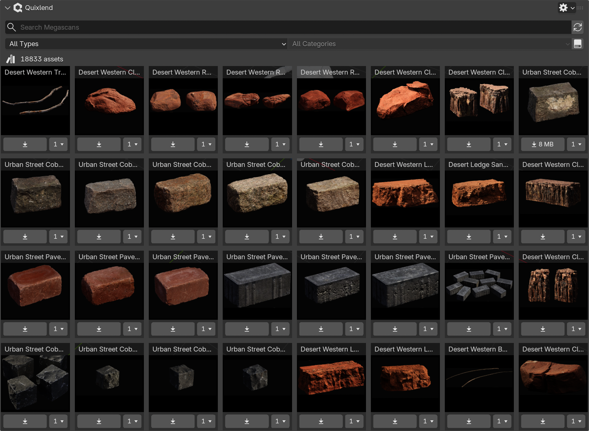
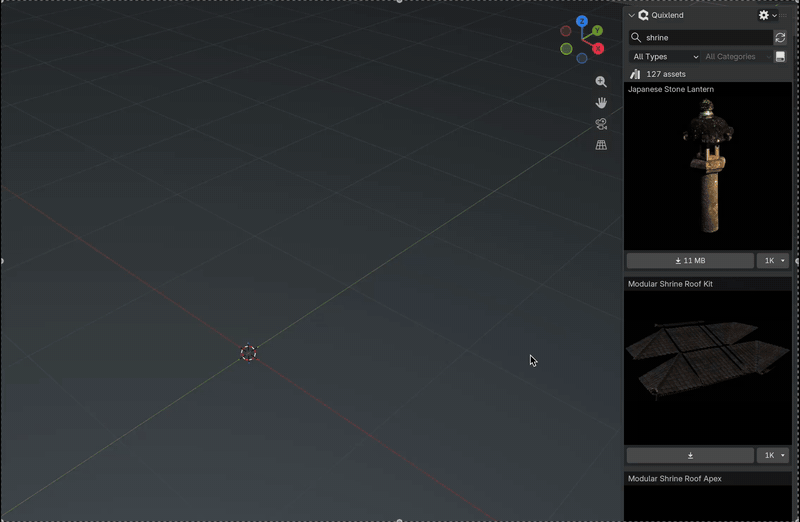
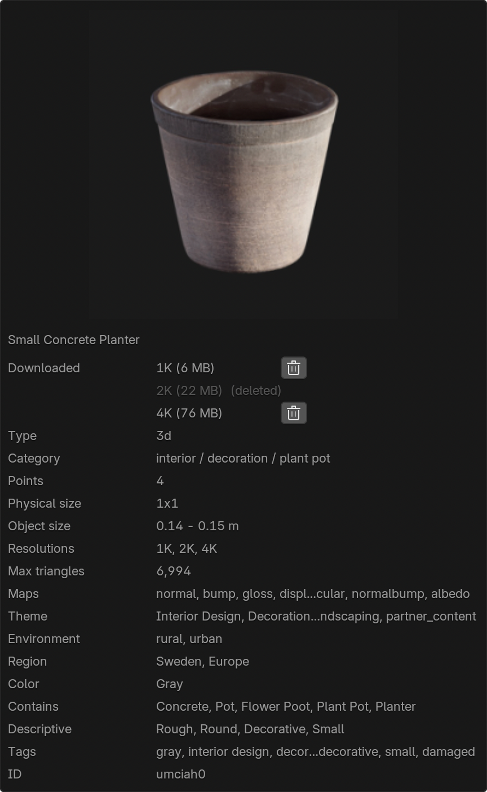
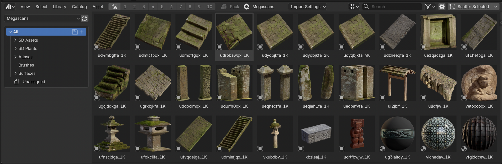

<h1 align="center">Quixlend</h1>

<p align="center">
  Browse your Megascans library and bring assets into Blender in one click.
</p>

<p align="center">
  
  
  
</p>

An unofficial Blender add-on that talks directly to Quixel. It doesn't steal or bypass anything: it only lets you download the assets that are already in your own Megascans library. You still need a Quixel account.

It's tiny: **under 200 KB**, where the Bridge app is 600 MB+.

<p align="center">
  
</p>

## Features

### Download and import in a click

Search the catalog from the 3D Viewport sidebar, download an asset, then import it or drag it into the scene.

<p align="center">
  
</p>

### Multiple resolutions per asset

<table>
<tr>
<td valign="top">

Every asset can be fetched at **1K, 2K, 4K or 8K**. Pick the resolution on the card, and download several resolutions of the same asset side by side.

The details popup lists every resolution on disk with its size, and lets you delete the ones you no longer need.

</td>
<td width="300" valign="top">



</td>
</tr>
</table>

### Automatically in the Asset Browser

Downloaded assets are added to a Megascans asset library for you, with thumbnails, ready to use from Blender's Asset Browser.

<p align="center">
  
</p>

### And more

- **Anti-Tiling**: attach an Anti-Tiling node group to surfaces so textures don't visibly repeat (on by default, optional).
- **Color Variation**: a node group you can add to a material from the Shader Editor panel.
- **Tidy scenes**: optionally place each asset in its own sub-collection.

## Installation

Requires Blender 5.2 or newer and a Quixel account with the assets in your library.

### Drag and drop

**Drag this link into Blender** (adds the repository and installs Quixlend):

[Quixlend: drag me into Blender](https://github.com/notenderdreams/Quixlend/releases/latest/download/quixlend.zip?repository=https%3A%2F%2Fgithub.com%2Fnotenderdreams%2FQuixlend%2Freleases%2Flatest%2Fdownload%2Findex.json&blender_version_min=5.2.0)

### Add the repository

In Blender: **Edit → Preferences → Get Extensions → Repositories → `+` → Add Remote Repository**, then paste:

```
https://github.com/notenderdreams/Quixlend/releases/latest/download/index.json
```

Search for **Quixlend** under Get Extensions and install it.

### Install from disk

Download the zip from [Releases](https://github.com/notenderdreams/Quixlend/releases), then **Preferences → Add-ons → Install from Disk** and pick it. This install won't receive updates.

### First run

Enable **Quixlend**, sign in to your Quixel account in the add-on preferences, and open the **Quixlend** tab in the 3D Viewport sidebar.

## Disclaimer

Quixlend is an independent project, not affiliated with or endorsed by Quixel or Epic Games. It only downloads assets your account already owns. Megascans content stays under its own license terms.

## License

[MIT](LICENSE)
